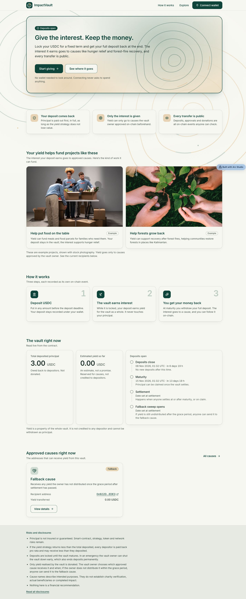
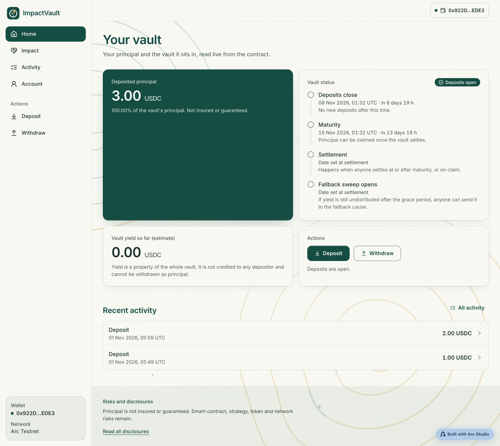
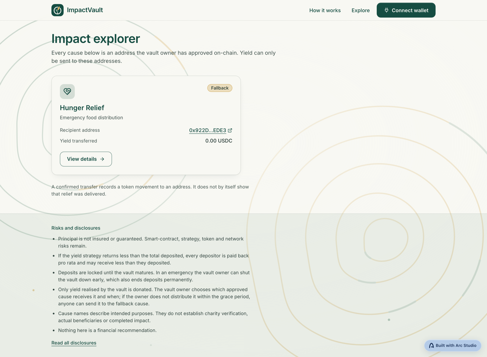

# Impact Vault

**Give your yield, keep your money.**

Impact Vault is a yield-giving vault on [Arc](https://arc.io), Circle's stablecoin-native L1. Depositors lock USDC until a fixed maturity and get **100% of their principal back**. Only the yield earned along the way is donated — and it can only ever go to causes the vault owner has approved on-chain.

Charitable giving usually asks people to choose between their savings and their values. Impact Vault removes the choice: your capital comes home, your interest does the work. Every approval, distribution and withdrawal is a public event on Arc, so donors can verify where the money went instead of taking a report's word for it.

Built with [Arc Studio](https://studio.arc.io) (https://studio.arc.io/app/ce2d0910-98fd-4df0-8829-093186ce2021) for [Arc Microgrants](https://dorahacks.io/hackathon/arc-microgrants-2/detail).

<p align="center">
  
</p>

<p align="center">
  
  
</p>

---

## How it works

| Phase | What happens |
| --- | --- |
| **Open** | Deposit USDC before the deposit deadline. Your principal is recorded under your wallet and invested in the vault's ERC-4626 yield strategy. |
| **Locked** | The strategy earns yield for the vault as a whole. Yield is never credited to individual depositors, so no one can withdraw someone else's gain. |
| **Matured** | Anyone can settle the vault. Principal and realised yield are separated and reserved. |
| **Settled** | Every depositor withdraws their full original deposit. The owner distributes the realised yield to approved causes. |

Four properties make it trustworthy rather than merely transparent:

- **Principal is senior.** Depositors are made whole before a single unit of yield can be distributed. The contract separates `totalPrincipal` from the yield pool and will not let the owner touch the former.
- **The owner cannot choose a new recipient at payout time.** Causes must be approved on-chain *before* they can receive anything, and each approval is its own public event.
- **Nobody can sit on the money.** If the owner has not distributed the yield within the claim grace period (minimum 7 days, enforced in the constructor), *anyone* can sweep what is left to the fallback cause fixed at deployment.
- **There is an exit.** The owner can halt deposits and let depositors leave early. If the strategy cannot be redeemed for cash, depositors receive their pro-rata share of the strategy position in kind instead.

One honest caveat, stated plainly because it is a money app: principal is returned in full **as long as the yield strategy returns at least the total deposited**. If the strategy loses value, depositors share that loss proportionally. The vault does not and cannot promise otherwise, and the interface never describes projected yield as a guarantee.

## Architecture

```
  Browser (React + wagmi/viem)
         │  reads: contract views + event logs
         │  writes: user-signed transactions
         ▼
  ImpactVault.sol  ──invests──▶  ERC-4626 strategy  ──holds──▶  USDC
   (Ownable2Step,                                              (Arc native
    Pausable,                                                   gas token)
    ReentrancyGuard)
```

**There is no backend, and that is the point.** The browser talks straight to Arc. Every figure on screen is a contract read, and the activity ledger is reconstructed from on-chain events — there is no server, no database and no indexer to trust, go down, or disagree with the chain. That also means nothing to deploy or pay for beyond a static bundle.

The yield source is a pluggable ERC-4626 vault, passed once in the constructor and immutable thereafter. Pointing Impact Vault at a different lending market means a new deployment, not a privileged setter.

## Tech stack

React 18 · Vite · TypeScript · Tailwind CSS · wagmi v2 · viem · ConnectKit · Solidity 0.8.28 · Foundry · OpenZeppelin 5.6

Network: Arc Testnet (chain ID `5042002`). USDC is the native gas token on Arc, so deposits reserve a fee.

## Live deployment

### Arc Testnet

| | |
| --- | --- |
| ImpactVault | [`0xd56B2ba0c4082D74856e4f739DaF9174507eaA6b`](https://explorer.testnet.arc.io/address/0xd56B2ba0c4082D74856e4f739DaF9174507eaA6b) |
| Yield strategy | [`0xb0bae8c07a5c738aa7eac07eccd0de0c4009bb71`](https://explorer.testnet.arc.io/address/0xb0bae8c07a5c738aa7eac07eccd0de0c4009bb71) |
| USDC | `0x3600000000000000000000000000000000000000` |
| Deploy block | `70101849` |

### Arc Mainnet

Not yet deployed. Chain ID `5042`; USDC predeploy is `0x3600000000000000000000000000000000000000`.

| | |
| --- | --- |
| ImpactVault | `0x…` _(pending)_ |
| Yield strategy | `0x…` _(pending — must be an audited ERC-4626 vault, see below)_ |
| Deploy block | _(pending)_ |

---

## Quick start

Prerequisites: [Bun](https://bun.sh). [Foundry](https://book.getfoundry.sh) is needed only to build, test or deploy contracts.

```bash
bun install
bun run dev          # http://localhost:5173
```

```bash
bun run check        # lint + typecheck
bun run test         # unit tests (pure logic, no network)
bun run contracts:build
bun run contracts:test
```

## Deploying the frontend

The app is a static bundle — any static host works (Arc Studio, Vercel, Netlify, Cloudflare Pages, S3 + CDN).

```bash
bun run build        # emits dist/
bun run preview      # serve dist/ locally to sanity-check it
```

Configuration is entirely environment-driven, so **moving networks never requires a code change**. Set these at build time:

| Variable | Purpose |
| --- | --- |
| `VITE_VAULT_ADDRESS` | ImpactVault address |
| `VITE_STRATEGY_ADDRESS` | ERC-4626 strategy address |
| `VITE_USDC_ADDRESS` | USDC address |
| `VITE_VAULT_DEPLOY_BLOCK` | First block to scan for events — set to the vault's deploy block so the ledger does not scan from genesis |
| `VITE_CAUSES` | JSON `[{"address","name","purpose"}]` giving display names to approved causes. The contract only stores addresses; an approved cause with no entry is shown by address and never under an invented name |

```bash
VITE_VAULT_ADDRESS=0x… \
VITE_STRATEGY_ADDRESS=0x… \
VITE_VAULT_DEPLOY_BLOCK=… \
bun run build
```

Defaults in `src/chain/config.ts` point at the live testnet deployment, so a plain `bun run build` produces a working testnet app. For mainnet, also switch `CHAIN` in that file to Arc mainnet.

## Deploying the backend

None required. See [Architecture](#architecture) — the client reads contract state and event logs directly.

## Deploying the contracts

### Arc Testnet

Redeploy the vault against the existing strategy. This reuses the on-chain init code of the current deployment, so **Foundry is not required** and the bytecode is identical to what is already live:

```bash
bun --env-file=secrets scripts/redeploy-vault.ts            # dry run: prints args, gas and cost
bun --env-file=secrets scripts/redeploy-vault.ts --broadcast
```

`secrets` (git-ignored) needs `DEV_ETH_PRIVATE_KEY` for a wallet holding testnet USDC — on Arc that same balance pays gas. The script refuses to run if the fetched init code does not decode to the expected constructor arguments, and verifies `owner`, `strategy`, `usdc` and the timeline after deploying.

Then point the app at the new address via `VITE_VAULT_ADDRESS` and `VITE_VAULT_DEPLOY_BLOCK` (both printed on success).

An end-to-end test against the live network is available. It spends ~1 test USDC:

```bash
bun run test:testnet
```

### Arc Mainnet

Use `contracts/script/DeployImpactVaultMainnet.s.sol`. It hard-asserts chain ID `5042`, takes every value from the environment with no defaults, preflights all of them before broadcasting, and re-checks the deployed state afterwards.

```bash
export STRATEGY_ADDRESS=0x…     # audited ERC-4626 vault whose asset is Arc USDC, synchronous redemption
export ADMIN_ADDRESS=0x…        # vault owner — use a multisig or hardware wallet
export FALLBACK_CAUSE=0x…       # must differ from ADMIN_ADDRESS
export DEPOSIT_DEADLINE=…       # unix seconds, must be >24h out
export MATURITY=…               # unix seconds, >= DEPOSIT_DEADLINE
export CLAIM_GRACE_PERIOD=604800  # >= 7 days

# Simulate against live state first — no --broadcast.
forge script contracts/script/DeployImpactVaultMainnet.s.sol:DeployImpactVaultMainnet \
  --rpc-url "$ARC_MAINNET_RPC_URL" --account <keystore-name>

# Then broadcast.
forge script contracts/script/DeployImpactVaultMainnet.s.sol:DeployImpactVaultMainnet \
  --rpc-url "$ARC_MAINNET_RPC_URL" --account <keystore-name> --broadcast
```

Sign with an encrypted keystore or hardware wallet. Never pass a raw private key on the command line.

Before going to mainnet:

- [ ] Replace the strategy with an **audited** ERC-4626 vault on Arc USDC. The included reference strategy is for testnet only and must not hold real funds.
- [ ] Set `ADMIN_ADDRESS` to a multisig. Admin powers are listed below, and `Ownable2Step` means a transfer needs the new owner to accept.
- [ ] Fund the admin address with USDC. Arc charges gas in USDC, so **an admin that holds none cannot act at all** — including `transferOwnership`.
- [ ] Verify the contracts on the Arc explorer.
- [ ] Commission a security review.

## Owner powers

The owner is deliberately constrained. It can approve and remove causes, distribute realised yield to an approved cause, raise the deposit cap, pause and unpause deposits, trigger emergency shutdown, enable in-kind exit, and rescue unreserved tokens. It **cannot** withdraw depositor principal, redirect yield to an unapproved address, or lower the deposit cap once deposits have begun.

The admin workspace at `/admin` is a convenience, not a security boundary — it only hides controls. Every admin action is enforced by the contract, which rejects any other caller with `OwnableUnauthorizedAccount`.

## Design notes

The interface is built on one rule: **never show a number it cannot prove.** When a read fails, figures are withheld rather than rendered as zero, because an unknown balance is not an empty one. Projected yield is always labelled an estimate. Approved causes with no configured display name appear as raw addresses rather than invented charity names.

It targets WCAG 2.2 AA — visible focus, 44px touch targets, full keyboard reachability, text contrast of at least 4.5:1 and non-text contrast of at least 3:1 — and all motion is CSS-driven so `prefers-reduced-motion` switches it off wholesale.

## Status and security

Impact Vault is working software on Arc Testnet and the contracts are built for production use: `Ownable2Step`, `Pausable`, `ReentrancyGuard`, integer-only USDC maths, balance-delta assertions around every external token movement, and donation-inflation protection on deposits.

It has **not** had a third-party security audit, and the bundled yield strategy is a reference implementation for testnet. Treat the mainnet checklist above as a prerequisite, not a suggestion.

## Repository layout

```
contracts/            ImpactVault.sol, reference strategy, deploy scripts
src/chain/            config, ABIs, wagmi hooks, pure derivations, event → ledger
src/components/       layout, UI primitives, vault widgets, signature art
src/pages/            public pages, wallet pages, /admin workspace
scripts/              redeploy-vault.ts, e2e-testnet.ts, dev-signer.ts
tests/                unit tests for derivations and formatting
```

Business logic lives in `src/chain/derive.ts` as pure functions over a contract snapshot, which is why phase, payout and error handling are unit-testable without a network.

## License

MIT
